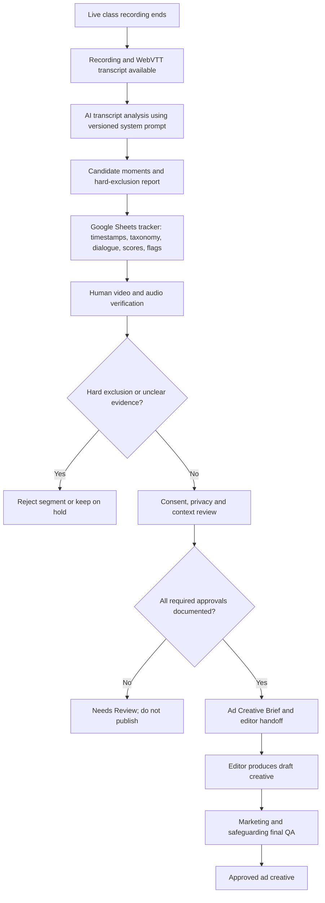

# Workflow Architecture

## Current prototype

This assignment implements a no-code / AI-assisted process using the provided WebVTT transcripts, the exact content-mining system prompt, a Google Sheets candidate tracker and manual review of the original recordings. It is a designed workflow and working prompt-and-tracker prototype, not a deployed automated application or production integration.

## Inputs and outputs

| Stage | Input | Output | Control owner |
|---|---|---|---|
| Transcript intake | Recording reference and WebVTT | Session ID, source transcript, timestamp reference | Marketing operations |
| AI mining | Transcript, taxonomy and system prompt | Candidate table and rejection report | AI content analyst / operator |
| Tracker review | AI output | Structured candidate record and score | Marketing reviewer |
| A/V verification | Original recording and candidate time window | Confirmed or pending visual/audio evidence | Human reviewer |
| Compliance gate | Candidate, context and consent record | Rejected, Needs Review or cleared for production | Safeguarding / authorised approver |
| Editor handoff | Cleared brief and source time window | Draft vertical creative | Video editor |
| Final QA | Draft creative and approval record | Approved or returned for revision | Marketing + safeguarding |

## Human-in-the-loop boundary

AI proposes candidate moments and structures evidence. It does not independently establish consent, identify whether a child is comfortable, determine full visual context from transcript text, or authorise advertising publication.
